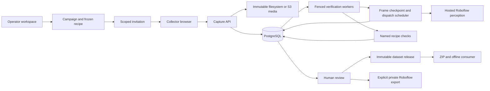

# Counterpart implementation architecture

Decision date: 2026-09-26. Selected by the user; build authorized. This document supersedes planning-only historical notes. This is a new repository; CoverageCV stays untouched.

## Product and scope

Counterpart helps a collector make two real observations that differ in a specified relation, checks named controls while the scene is still repairable, and publishes the evidence as one reproducible record. Campaign admission, human review and immutable dataset releases form the complete operator workflow around capture. The opening demo needs a laptop/phone, cup and bottle. Roboflow is the actual perception service and optional destination for accepted annotation assets, not a logo on a generic dashboard.

Two recipes:

1. **Switch sides**: photograph one bottle left of one cup; move the bottle to the right while keeping the cup/camera approximately fixed. Verify confidence, uniqueness, separation, reference position and object scale. This is an image-plane relation, not a claim about physical 3-D geometry or every pixel remaining unchanged.
2. **Reverse arrival order**: collect two short frame sequences, same start/end arrangement, in which the objects enter a visible target band in opposite order. Require stable initial/final observations, ordered sampling, a clear pause between arrivals, nonoverlapping arrival intervals, no interruption and sufficient confidence. Never infer unseen exact motion onset from sparse frames. Persist sampled original JPEGs with monotonic capture times; an optional encoded clip is presentation evidence, never the timing oracle.

Every task carries versioned parameters, model identity and verification evidence. A verifier can say uncertain and explain what to fix. Detector confidence is not proof of truth. Same-class instance identity, unobserved actions and physical causality are explicit limitations.

## Reuse and service boundaries

- Native getUserMedia and requestVideoFrameCallback for browser capture; React/TypeScript/Vite UI. No browser ML. A native recorder is optional, not required for the canonical sequence.
- FastAPI/Pydantic typed API; psycopg PostgreSQL transactions; immutable filesystem and S3-compatible object stores behind a shared interface. Filesystem media needs a shared persistent volume across processes; the S3 adapter supports separate API/worker hosts and has been exercised against a real HTTP emulator.
- Roboflow Serverless RF-DETR Small, explicit canonical model `coco/39`, header-only auth through HTTPX. Current official docs/source support the endpoint; actual hosted probes established account/route compatibility and six tabletop source relations; physical collector quality remains a separate gate.
- Postgres stores sessions, immutable captures, observation/check records, fenced leased jobs, budget reservations, publication manifests and export receipts. Reuse established transactional/outbox patterns rather than inventing queue semantics. No broker/Temporal/Kubernetes is required for this topology.
- API and worker are separate processes. A dev supervisor may start both. API never synchronously performs model compute. No local inference, training or model evaluation.

## Implemented collection data path

A worker-presence registry distinguishes a live DB from standing worker capacity. Collection pause gates new joins/captures but keeps recorded evidence accessible; admitted in-flight work can finish. Invitation revocation stops new joins, while session capability revocation is deliberately not implied. Frozen review decisions stay inside releases even if the current review later changes. Exact same assets cannot enter different partitions of a release.

Inference results are checkpointed per exact media/model configuration and include original observation provenance. Frame progress is separate from recipe acceptance. Filesystem and S3 writes are immutable; shared/exclusive lifecycle guards prevent orphan cleanup racing an upload. Backup/restore tests preserve the model-budget ledger, but restoring historical usage still requires independent provider reconciliation before calls resume.

## Consistency and recovery

A session has a secret capability (stored hashed), a durable capture revision and a connection epoch. Capabilities are bearer secrets, not user accounts. A single-workspace operator uses a signed HttpOnly cookie; scoped invitations admit collectors without sharing that credential. Network exposure requires operator mode, configured origins/hosts and HTTPS, apart from an explicitly loopback-only development container exception. This is not a multi-tenant identity service.

Committed submissions are immutable records keyed by session and idempotency key. Replaying the same key/body returns the same capture; changing the body returns 409. Media is durably stored before its DB reference is committed. An accepted baseline survives retries/disconnects. A replacement attempt advances revision and fences old jobs; rejected candidates do not erase the baseline.

Connection epoch fences previews and recovery observations. Resuming does not erase committed evidence or silently prove the real scene unchanged. A partially collected pair requires a new recovery observation of designated controls before its next submission. A completed pair needs no physical re-observation to download its already recorded evidence.

Worker claims use FOR UPDATE SKIP LOCKED, bounded attempts and lease tokens. A worker that loses its lease cannot apply a result even if the remote call later succeeds. The acceptance transaction matches capture/revision/state preconditions. Heartbeats renew during multi-frame work. Crash after remote inference can cause another paid call: reserve every dispatched image and never refund ambiguous timeouts. At-most-once local acceptance is achievable; exactly-once remote compute is not promised.

## Two scheduling paths

Previews are replaceable hints: at most one pending preview per session, supersede unscheduled old work, monotonic result sequence within current epoch, finite feedback age. A newer submitted preview does not automatically invalidate every still-useful in-flight observation. Preview results never accept a committed capture.

Saved image/sequence evidence is durable. Never drop temporal frames using the preview policy. Prioritize committed verification, then fairly choose recent previews by session service time; keep bounded global and per-session admission. Observable overload must reduce/stop preview submission, not create an unbounded queue. Export is lower priority than collector-facing verification. Work-conserving fairness must be tested with a noisy collector and another waiting collector.

## Publication and export

Publishing atomically creates one complete immutable manifest for an accepted baseline/counterpart, plus a disabled export intent. Approved live pairs enter the exporter only through an explicit, atomic selected-batch request to a verified private destination. Unique session publication prevents double counting on repeated requests. Manifest records asset hashes/times, recipe/verifier/model versions, observations, decisions, provenance and one session-level split. Never split members of the pair across train/test.

Roboflow image uploads are external effects. Record each confirmed provider image ID, reconcile ambiguous outcomes and preserve explicit export status. A local complete pair is distinct from a fully confirmed remote export; partial upload must never be represented as a complete Roboflow export. Fixture replay records cannot be sent to the real dataset. Do not auto-create a public Roboflow project with potentially private camera images.

## Security, budget and truthful evidence

Credentials loaded only server-side from environment or the existing private credentials file; no keys in browser bundles, logs or fixtures. Inference uses header-only auth. Roboflow dataset endpoints require their documented query-key transport; this narrow provider-specific exception uses sanitized exceptions and HTTPX log redaction. Capability auth protects sessions and media. Size/count/pixel/time limits apply before verification. Decode raster metadata safely, disallow arbitrary remote image URLs, reject nonfinite geometry/timestamps and malformed provider data. Restrict production origins and camera secure-context requirements.

Cloud budget ledger is durable, atomically reserved, fail closed. The private development allowance is 512 image attempts; eight reservations were used by the initial route probes and six-photo diagnostic. Portable defaults remain 128. Per-frame checkpoints reuse successful observations while each potentially new request reserves independently. Modal has user-confirmed $3.39 remaining; current spend-limit confirmation pending, so no Modal workloads. Default development provider is explicit replay fixture, visibly labeled. Fixtures exercise orchestration, not CV accuracy or latency. Real provider smoke, physical user capture, infra fault tests and load replay are distinct reports.

## Delivery gates

1. Review reusable sources and freeze protocol/state contracts.
2. Implement domain checks, DB transitions/leases, provider adapters, API and polished capture UI in parallel with file ownership.
3. Run verifier unit/property tests and real PostgreSQL race/fault tests, API integration tests and frontend build/browser interaction tests.
4. Run bounded cloud account/model smoke, save sanitized provenance. No passing claim for human desk captures until actually collected.
5. Demonstrate resumable pair construction, targeted repair, complete export, worker recovery and stale-result rejection; report measured infrastructure results with disclosed workload. Document run/restart commands, known gaps and next physical validation.

## Rejected shortcuts

No client-supplied detection truth on live sessions; no automatic acceptance based on a preview; no exactly-once external upload claim; no silent fixture fallback when RF fails; no queue full of obsolete camera frames; no acceptance when an image is ambiguous; no elaborate services without a concrete failure they solve.
