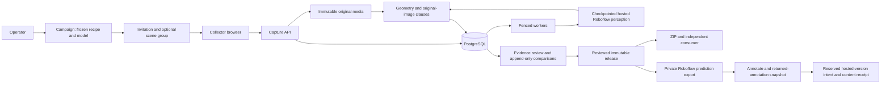

# Counterpart implementation architecture

Selected and authorized 2026-09-26; updated during original-scope closure on 2026-09-27 UTC. This describes implemented boundaries and invariants. [Original-scope audit](../ORIGINAL_SCOPE_AUDIT.md) maps historical omissions to their repairs; [validation](../VALIDATION_REPORT.md) records which checks actually ran. Implementation does not itself establish physical collection quality or completion of provider/deployment gates.

## Product and observable scope

Counterpart helps a collector record two real observations that differ in a specified relation, checks named controls while the scene can still be repaired, and publishes the original evidence as one reproducible record. Campaign admission, protected collection contracts, review of uncertain evidence and immutable releases surround the capture interaction. Roboflow supplies live object observations and the optional annotation/dataset delivery destination.

Two versioned recipe families are implemented:

1. **Switch sides:** move object A from left to right of object B, keeping the reference approximately fixed. Verify distinct visible roles, confidence, separation, reference geometry and apparent object scale. Relations are measured in the image plane.
2. **Reverse arrival order:** record two sequences with matching start/end arrangements but opposite observed arrival order in a target band. Require ordered sampling, stable endpoints, separable arrival intervals, suitable pauses, confidence and no interrupted recording. Original JPEG samples and monotonic timestamps are canonical; sparse samples do not reveal exact unseen motion onset.

New live sessions use recipe/verifier 2.3 with visual/appearance comparator 4.0. They add visible-background consistency, observed appearance continuity and up to three declared protected classes to the original geometric clauses. Plain backgrounds are supported without requiring corner features. Each clause and the final decision returns `pass`, `fail` or `unknown`. Acceptance requires every required clause to pass; uncertain appearance is not waived. Known independent failures dominate uncertainty; malformed evidence is a hard error. Historical 1.0/2.0/2.1/2.2 snapshots and generated replay retain their original rules and serialized results. This is a bounded reusable recipe family, not an arbitrary executable rule language.

## Components and data flow

- React/TypeScript/Vite uses native `getUserMedia` and `requestVideoFrameCallback`. IndexedDB retains immutable pending uploads and a local session library. There is no browser ML.
- FastAPI/Pydantic validates requests; psycopg/PostgreSQL supplies transactions, fenced leased work, identity, evidence history, budgets, review and publication. API and inference workers are separate processes.
- Roboflow Serverless RF-DETR Small (`coco/39` by default) runs hosted perception. Header-only authorization stays in the server adapter. Detector execution never happens on the user's local computer.
- Original bytes live in an immutable filesystem or S3-compatible store. Filesystem deployments need a shared persistent volume; S3 supports independent hosts. Classical bounded pixel checks read these exact bytes; they are not a trained local model.
- Versioned recipe and execution contracts, complete manifests and the independent portable consumer expose what was measured and how. No broker, Kubernetes or serialized stateful GPU tracker is required for this topology.

## Frozen recipe, model and scene identity

Campaign creation freezes its recipe snapshot and credential-free execution contract. Invitation admission copies those values transactionally into each session. Standalone creation freezes the API's configured detector. The execution digest covers provider, endpoint, versioned model ID, adapter namespace/version, normalization version, confidence threshold and disabled active learning. Credentials, network timeouts and queue limits are operational settings rather than perception semantics.

Workers compare their actual detector identity with the saved contract before entering the cache or reserving a call. Provider responses, cache hits and saved reference observations must name the expected model and configuration. A changed worker refuses the saved capture with a contract error; a compatible worker can later retry the same evidence. The inference cache includes exact asset bytes, dimensions and the full model configuration. This pins Counterpart's requested semantics, not cryptographic attestation of a vendor's remote weights.

Operators can create an opaque scene group and attach it to invitations across campaigns. Session admission freezes the group ID and display provenance. The partition is a deterministic hash of that ID; both halves and every declared related session stay together through human adjudication, releases, portable examples and Roboflow metadata. Names alone do not merge groups. Without an explicit group, the session itself is the split unit. Exact duplicate assets across release partitions are rejected independently. Operators must correctly declare related scenes; grouping is not automatic identity recognition.

Database guards reject mutation/removal of non-null session execution contracts and changes to campaign contracts, invitation group assignment or frozen session grouping. Initialization leaves historical missing fields missing instead of inventing a past contract. Explicit legacy model migration requires a named operator/reason, expected session revision, no active capture lease and one consistent identity across existing observations and completed crash-surviving frame calls. Only the exact known old adapter has a documented endpoint mapping. Conflicting or unknown provenance fails closed. Historical captures, pair manifests and releases are not rewritten.

See [execution contract](EXECUTION_CONTRACT.md) and [collection contracts](COLLECTIONS.md).

## Capture consistency and recovery

A session has a hashed bearer capability, capture revision and connection epoch. Committed submissions bind an idempotency key to an immutable request fingerprint. Repeating the same body returns the same capture; changing it returns a conflict. Original media is stored durably before its database reference commits. Rejected candidates preserve an accepted reference; replacing the baseline deliberately advances the revision and fences obsolete jobs.

Connection epochs fence preview and recovery observations. Resuming preserves saved work but does not imply that the external physical scene stayed fixed. Partial collection requires a new observation of designated controls. A complete pair can be downloaded without a new physical check. Lost-response browser retries retain their original images, timestamps and identities.

Workers claim with `FOR UPDATE SKIP LOCKED`, bounded attempts, expiring lease tokens and a consistent lock order. Completion requires the current lease, capture, revision and state preconditions. Heartbeats preserve ownership during multi-frame work. An expired worker cannot apply a late result, even if its remote request succeeds. Durable per-frame observations let retries reuse confirmed outputs with original provenance. A crash before saving a remote result may require another paid call; every dispatch reserves usage, including ambiguous timeouts. There is no exactly-once remote-compute claim.

Worker presence uses incarnation fencing and freshness, distinguishing a reachable database from available workers. Pausing a campaign blocks new joins/captures while preserving receipts, evidence reads and admitted work. Revoking an invitation blocks new joins, not existing session capabilities.

## Preview scheduling and bounded inference

Previews are disposable hints: one pending preview per session, coalesce obsolete unscheduled work, monotonic displayed sequence within the current epoch and finite feedback age. A newer pending preview does not invalidate every still-useful in-flight result. Preview results never approve a committed image.

Committed stills and temporal samples are durable and have priority. Recent previews are selected fairly by session service time. Global/per-session dispatch admission, preview caps and browser pause behavior bound work; export runs below collector verification. Overload may reduce delivered feedback or reject admission. It cannot promise constant latency beyond available service.

The comparative scheduler harness uses production submit/claim/finish/snapshot operations in isolated PostgreSQL schemas. It compares Counterpart with bounded latest-preview FIFO and sampled FIFO under matched offered traffic and synthetic service traces. Persisted feedback age, snapshot-observed age, periods without feedback, fairness, queue state and committed completion are separate metrics. This is not hosted model latency or a rendered browser benchmark. Execution status and results belong in [feedback benchmark](../FEEDBACK_BENCHMARK.md); tests of the harness alone do not establish a performance win.

## Original-image controls

The v2 worker reads immutable media itself; no client-supplied transform or descriptor is trusted. Bytes must match asset SHA-256, size, dimensions and decode bounds. Images are downsampled to at most 640 pixels per side; at most 900 ORB features are extracted. Plausible detected objects are masked from background registration. Reciprocal descriptor matches feed a seeded, bounded RANSAC 2-D similarity fit. Distributed support, inlier/residual requirements and camera translation/rotation/scale bounds determine pass, fail or insufficient evidence. A transform never compensates away forbidden camera motion to produce a pass.

Historical recipe 2.0 compares role/protected-object crops using color histograms and normalized patches. Recipe 2.1 retains its original strong-change guard and registered-pixel comparison. Recipe 2.2 compares corresponding object coordinates after estimating illumination from shared background; existing geometric limits still apply. For separated moved objects, each image exposes the background behind the other's original object position. Registered differences provide silhouettes and row occupancy profiles. Recipe 2.2 tests whether color changes in five height bands can be explained by a bounded scalar contribution from the exposed background. These fitted consistency coefficients are not calibrated opacity or per-pixel alpha mattes. A passing corrected comparison supersedes misleading raw-color disagreement; otherwise substantial raw changes remain failures. These bounded checks address transparent objects whose raw crop colors change with the background. Insufficient exposed background, ambiguous overlap or disagreement remains blocking uncertainty. Protected classes must be distinct from the two named roles and one another. Their positions and apparent sizes are checked in the registered scene. Every temporal sample is evaluated against the original reference, not only endpoints. Native OpenCV uses one thread with OpenCL disabled; the pipeline retains the reference and current decoded image rather than a decoded video batch.

Recipe 2.3 initializes the first original image as a reference without claiming temporal stability. Subsequent images compare broadly distributed background pixels, including flat regions; named objects have their own required geometry and appearance checks and are excluded from dense background comparison. Other detected furniture remains background evidence. Reliable ORB estimates still reject excessive camera movement. When features are sparse, only a bounded translation search is allowed. Small global exposure changes and bounded smooth intensity changes are accounted for; local structural and color evidence guards against concealing new objects as shadows. Appearance 4.0 preserves silhouette area during resampling. Intermediate overlapping temporal movers additionally require agreement of both whole-object and interior pixels in object coordinates.

These checks establish observable appearance and 2-D background consistency. They cannot establish physical instance identity, 3-D pose, constant lighting, detector truth, or every undeclared change. Identical replacements can escape appearance checks; visually indistinguishable camera movement on a blank background cannot be detected. Excessive lighting changes, occlusion or inadequate visible background can still be unknown. Thresholds are versioned engineering defaults, tested on generated controls and saved repair examples rather than a held-out physical accuracy study. See [visual verification](VISUAL_VERIFICATION.md).

## Evidence revisions and uncertainty review

The operator workbench separates original machine results, new verifier comparisons, attempt dispositions, baseline authorization and pair adjudication. Each operation binds exact source evidence and uses optimistic concurrency plus idempotency.

Re-verification chooses an exact registered recipe version, validates saved original media/observations and the original reference, and appends a new decision with both snapshots and evidence hashes. It makes zero provider calls. A baseline authorization does not transfer to a different recipe version. A later comparison neither overwrites an original result nor inherits a prior release approval. Database triggers prevent updates/deletes of revision and review history.

Standalone 2.0/2.1/2.2 observations can also be rechecked into a separate 2.3 collection using their exact saved pixels and model observations. This supports a complete saved pair or the latest first photo alone. The authenticated operation has a durable idempotent receipt and checks the source revision/epoch before and after computation. Original captures, decisions and contracts remain unchanged. Derivation links preserve the source split assignment and capture timestamps. The collector automatically requests this recheck for background/appearance-only uncertainty, preserving camera orientation for later retakes. A derived incomplete pair requires a fresh scene-recovery check before further capture. Frozen campaigns and human-authorized baselines are ineligible; a rejected new comparison remains rejected. Retries after an upgrade recover the originally recorded child and target version; new request keys use the current version. No new inference call or human approval is hidden in this operation.

A machine-refused first observation may be usable for continued collection when role geometry already passes and only its original-image registration/appearance clauses are unknown. The operator can explicitly authorize that baseline with a specific answer, all required criteria and a rationale. Missing/ambiguous role geometry, known failed controls and corrupt evidence are ineligible. The original decision stays refused. A separate immutable authorization row binds session, capture, recipe, model, answer and evidence; database triggers require the active session and subsequent capture copies to match that row exactly. Replacing a baseline clears only active authority; a duplicate old request cannot reactivate it. Unresolved recovery remains explicit.

Subsequent counterpart checks still run under that separately bound authority. Ordinary machine-only publication refuses the human-authorized path. Full-pair adjudication requires inspection of original media and every named control, independently reproduces original decisions, and refuses known failures or structurally invalid evidence. The resulting pair preserves original capture roles/results and records human-origin labels. It starts with ordinary pair review pending; a separate approval is required before release. A human review can be wrong and is not automatically independent ground truth.

See [evidence revisions](../EVIDENCE_REVISIONS.md).

## Local publication and portable releases

Machine publication atomically creates one complete manifest and a disabled export intent; unique session publication prevents duplicates. Human adjudication creates an explicitly different pair schema without relabeling machine observations. Both routes preserve original bytes/times, capture/reference relationships, recipe/model versions, scene grouping and provenance.

Release creation freezes the selected approved pairs and exact review snapshots with idempotent membership. Later reviews do not alter an existing release. Content-derived identity, VQA JSONL and original media form a portable ZIP. Archive creation uses disk spooling and a bound including final ZIP metadata. The independent consumer validates paths, counts, media bytes/dimensions/hashes, exact JSONL, recipe/model contracts, original decisions, explicit human authority, grouping and cross-split duplicate assets. It accepts historical formats without retroactively adding history. Hashes prove consistency, not who authored a dataset.

## Roboflow annotation and version delivery

Reviewed live pairs may be queued explicitly as an atomic selected batch to a server-verified private project. Public or changed destinations fail closed. Original detector boxes are uploaded as **predictions**, including for human-adjudicated pairs; uncertain boxes do not become annotation ground truth. Export records write-ahead asset phases, confirmed image IDs and bounded read-only reconciliation. Unknown upload/prediction outcomes are not blindly repeated. Local publication is distinct from complete remote export.

Operators correct/accept boxes in Roboflow Annotate. Counterpart then pulls actual image-detail annotations into immutable snapshots bound to the approved local release, source hashes, provider IDs, dimensions, partitions and returned boxes. Counterpart requires its own explicit snapshot approval rather than guessing a provider human-review state. Polygon/mask/keypoint formats are outside this object-detection adapter and are refused.

Version generation requires a dedicated project whose inventory exactly matches the approved selection, all images in the dataset, unchanged annotations and a current server-side included-credit allowance. A durable reservation and `issuing` state commit before the one external generation write. Generation uses no augmentation or preprocessing. A lost response becomes `uncertain`; the reserved attempt is retained and later progress uses reads. Concurrent advances cannot double-spend the same local allowance.

A version ACK means `generated`, not verified. Ready metadata and operator-imported original-size COCO documents must match membership, partitions, dimensions and corrected boxes before an immutable content receipt says `verified`. After an uncertain write, a new ready candidate may be reconciled explicitly with a matching artifact; prior versions are ineligible. Imported JSON is not authenticated provider-origin evidence and does not prove remote pixel identity. External project inventory is not transactionally locked; concurrent provider writers remain an external race. A dedicated private release project and final content checks narrow that risk.

The current workspace's private-project restriction keeps automatic camera export disabled. Generated public cards test transport separately. See [Roboflow delivery](../ROBOFLOW_DELIVERY.md) for states, controls, executed probes and limits.

## Storage, deployment, security and budget

Filesystem writes use content identities, bounded reads and atomic immutable creation. S3 uses conditional creation and read-back verification; retryable outages remain distinct from corruption. Shared/exclusive lifecycle guards coordinate uploads, orphan cleanup and backups. Cleanup preserves referenced pair/release assets. Actual PostgreSQL backup/restore tests include historical releases, new evidence tables, immutable authorization guards and external-effect uncertainty. Restoring an old ledger still requires independent provider usage reconciliation before cloud calls resume.

A single-workspace operator signs in with a server secret exchanged for an HttpOnly SameSite cookie; invitations admit collectors without sharing that credential. Capabilities protect session media. Production requires configured origins/hosts and secure cookies, with an explicit loopback-only container exception for local development. This is not a multi-tenant identity system. Docker packages API/worker as non-root processes, PostgreSQL and shared media/scratch storage; optional Caddy serves HTTPS. Local container and hosted deployment checks have separate evidence.

Credentials stay outside the repository and browser. Inference uses header authorization. The provider's dataset APIs require query-key transport, so those narrow adapters sanitize exceptions and redact HTTP logging. Raster size/count/pixel/time limits, finite geometry validation, trusted media readers and refusal of arbitrary remote image URLs constrain inputs. Portable artifacts contain provenance and evidence, not provider secrets.

Every potentially new inference dispatch reserves one durable image unit; ambiguous requests are never refunded. Hosted generation has a separate disabled-by-default attempt allowance and current billing-evidence reference. Application limits do not change provider billing controls. All execution remains within the user's zero-cash policy, and no local ML training/inference is permitted. Current allowance usage and provider experiments belong in execution records, not a stale architecture balance.

## Evidence boundaries

Software contract/race/fault tests, real database migration/restore, generated-pixel visual tests, browser/container exercises, hosted provider probes and the physical collection study answer different questions. Preserve each report's workload, source identity and limitations. Never infer an executed test from a plan or convert an ambiguous external effect into a success.

The user deferred real-camera validation. Positive fixed-reference/temporal acceptance, held-out scene quality, useful pairs per minute and superiority over a competent manual/simple-rule workflow remain unmeasured. The implementation provides the collection and evidence machinery for that evaluation; it does not replace the evaluation.
